<!-- ═══════════════════════════════════════════════════════════════════
     ANIKA JAIN · PLAYER 01
     Pixel art in assets/readme/ is generated by assets/readme/_src/build.py
     ═══════════════════════════════════════════════════════════════════ -->

<a href="#about">
  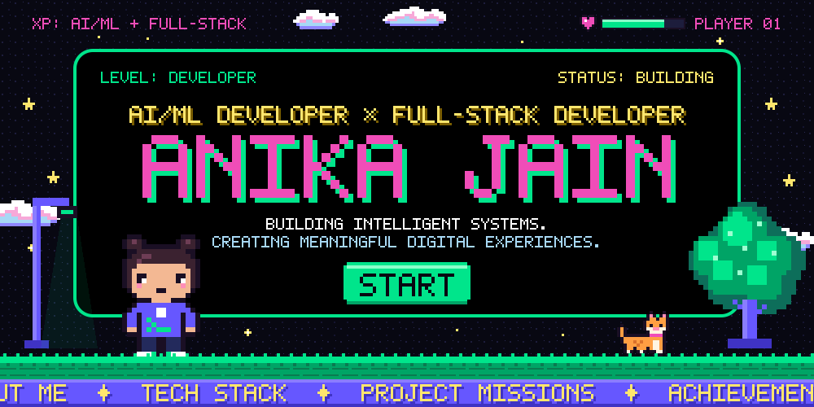
</a>

  <b>Building intelligent systems. Creating meaningful digital experiences.</b> 
  B.Tech CSE (Data Science &amp; AI) · SRM University, Delhi NCR · AI/ML × Full-Stack

  

    <b>LEVEL SELECT</b> &nbsp;▸&nbsp;
    <a href="#about">01 · Player</a> &nbsp;·&nbsp;
    <a href="#loadout">02 · Loadout</a> &nbsp;·&nbsp;
    <a href="#missions">03 · Missions</a> &nbsp;·&nbsp;
    <a href="#achievements">04 · Achievements</a> &nbsp;·&nbsp;
    <a href="#player-log">Player Log</a> &nbsp;·&nbsp;
    <a href="#stats">05 · Stats</a> &nbsp;·&nbsp;
    <a href="#next-level">Next Level</a>

<!-- ─────────────────────────── LEVEL 01 ─────────────────────────── -->

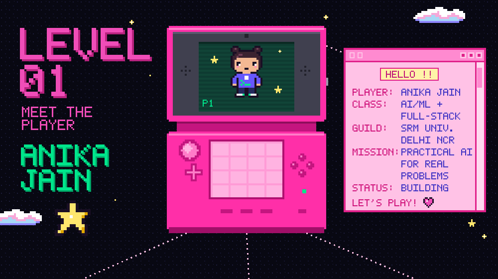

<table>
<tr>
<td width="34%" valign="top">

**Hi, I'm Anika** — a Computer Science undergrad specialising in Data Science & AI, working where **AI/ML meets full-stack development**.

My recent builds span computer vision for heritage conservation, ML ensembles for network threat detection and multimodal retrieval for lost-and-found search. Each one started from a real-world problem. I care about the whole path: the model, the API around it, and the interface someone actually uses.

▸ **Class** · AI/ML Developer × Full-Stack Developer 
▸ **Guild** · SRM University, Delhi NCR 
▸ **CGPA** · 9.28 / 10

</td>
<td width="33%" valign="top">

**B.Tech — Computer Science & Engineering**

▸ **Specialisation** Data Science & Artificial Intelligence

▸ **University** SRM University, Delhi NCR

▸ **Campaign** 2024 — 2028 · CGPA **9.28/10**

▸ **Side quests** <i>(in progress)</i> Data Structures & Algorithms · Web Development — Apna College

</td>
<td width="33%" valign="top">

▸ **Artificial Intelligence** <i>systems that reason over real data</i>

▸ **Machine Learning** <i>ensembles, evaluation, calibration</i>

▸ **Computer Vision** <i>segmentation &amp; re-identification</i>

▸ **Data Science** <i>from raw data to decisions</i>

▸ **Full-Stack Development** <i>MERN apps &amp; APIs</i>

▸ **Shipping it** <i>practical, scalable applications</i>

</td>
</tr>
</table>

<!-- ─────────────────────────── LEVEL 02 ─────────────────────────── -->

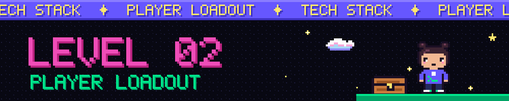

<table>
<tr>
<td width="50%" valign="top">

 C · C++ · Python · JavaScript · <b>SQL</b>

</td>
<td width="50%" valign="top">

 <i>Artificial Intelligence · Machine Learning · PyTorch · TensorFlow · scikit-learn · NumPy · Pandas · Matplotlib</i>

</td>
</tr>
<tr>
<td width="50%" valign="top">

 <b>MERN Stack</b> — MongoDB · Express.js · React.js · Node.js

</td>
<td width="50%" valign="top">

 <i>MySQL · PostgreSQL · MongoDB · IBM Cloudant</i>

</td>
</tr>
<tr>
<td width="50%" valign="top">

▸ Data Structures & Algorithms 
▸ Database Management Systems 
▸ Operating Systems 
▸ Computer Networks 
▸ Theory of Computation

</td>
<td width="50%" valign="top">

 

 <i>Git · GitHub · VS Code · Postman · Docker · Vercel · Firebase · GCP · Tableau · Power BI</i>
 <i>+ Antigravity · IBM Watson AI Services · CI/CD</i>

</td>
</tr>
</table>

<!-- ─────────────────────────── LEVEL 03 ─────────────────────────── -->

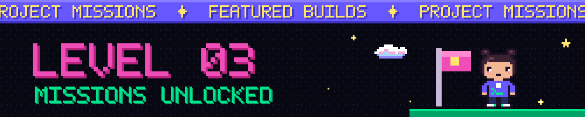

<table>
<tr>
<td width="150" align="center" valign="middle">
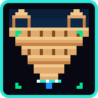
</td>
<td valign="top">

### JALDRISHTI
**_AI-Powered Digital Intelligence for India's Traditional Water Heritage_**

An AI-assisted heritage conservation platform for India's traditional water heritage, built on computer vision and **Indian Knowledge Systems (IKS)**.

▸ **Capabilities** · damage assessment · image analysis · restoration planning · 3D modelling 
▸ **Tech** · `Python` `OpenCV` `YOLOv8-Seg`

&nbsp;

</td>
</tr>
</table>

<table>
<tr>
<td valign="top">

### DRISHTI
**_AI-Powered Real-Time Network Threat Intelligence Platform_**

An ML-ensemble threat intelligence platform that detects cyber threats across **8.85M network flows**.

▸ **Capabilities** · ML-ensemble detection · dynamic feature extraction · risk scoring · explainable evidence graphs · real-time human-in-the-loop alerts 
▸ **Tech** · `Python` `scikit-learn` `XGBoost` `LightGBM` `CatBoost` `Pandas` `NumPy`

</td>
<td width="150" align="center" valign="middle">
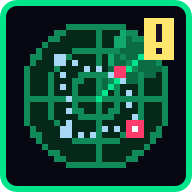
</td>
</tr>
</table>

<table>
<tr>
<td width="150" align="center" valign="middle">
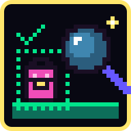
</td>
<td valign="top">

### BACK2U
**_AI-Powered Multimodal Lost & Found Platform_**

A multimodal lost-and-found platform that uses image–text retrieval to find **the same physical item** through instance-level re-identification.

▸ **Capabilities** · image–text retrieval · instance-level re-identification · multimodal reranking · uncertainty calibration · UI, API & database architecture 
▸ **Tech** · `PyTorch` `DINOv2` `Grounding DINO` `SigLIP2` `FAISS` `FastAPI`

</td>
</tr>
</table>

<!-- ─────────────────────────── LEVEL 04 ─────────────────────────── -->

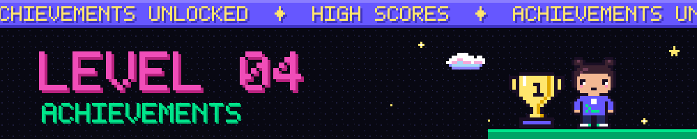

<table>
<tr>
<td width="50%" valign="top" align="center">

  

### Winner — Viksit Bharat Conclave 2026

**1st Position** · Parampara to Prototype — Design Hackathon 
SRM University Delhi-NCR · 8 October 2026 
Project: **Jaldrishti** · Team of 4

</td>
<td width="50%" valign="top" align="center">

  

### National-Level Finalist — IBM National Hackathon 2026

IBM Expert Labs, Coimbatore · 12–13 September 2026 
Qualified as **one of 8 campus finalists** 
Project: **DRISHTI** · Team of 4

</td>
</tr>
</table>

<!-- ─────────────────────────── PLAYER LOG ─────────────────────────── -->

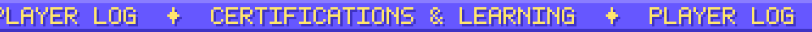

| ✦ | Quest | Issued by | Date |
|:-:|:--|:--|:--|
| ▸ | Tata GenAI Data Analytics Simulation | Forage | Oct 2026 |
| ▸ | Deloitte Data Analytics Simulation | Forage | Jan 2026 |
| ▸ | BCG X Data for Decision Makers Simulation | Forage | Jan 2026 |
| ▸ | Introduction to AI | Simplilearn SkillUp | Jan 2026 |
| ▸ | ServiceNow AI Foundation | FutureSkills Prime | — |
| ▸ | GenAI & Prompt Engineering (workshop) | AILytics × HackWithIndia | — |
| ▸ | Full-Stack Web Development (1-week workshop) | — | — |
| ▸ | SRM Builds 7.0 | Verge 2026 | — |

<b>Guild activity — developer community</b>

 

- **Developers Team Member, Appirates (SRM)** — contributing to student-led product development
- **Volunteer, Agentic AI/GenAI Bootcamp (SRM)** — supported a one-day technical event
- **Volunteer, Walk In with Zero Experience (SRM)**, Oct 2026 — supported hackathon preparation activities
- **Volunteer, From Campus to Global Careers (SRM)** — assisted with career-event coordination

<!-- ─────────────────────────── LEVEL 05 ─────────────────────────── -->

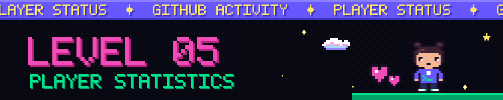

  

  

<!-- ─────────────────────────── NEXT LEVEL ─────────────────────────── -->

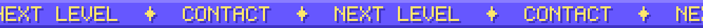

<h2 align="center">READY FOR THE NEXT LEVEL?</h2>

  Always up for a new quest: a hackathon team, a collaboration, or a problem that needs 
  a model <i>and</i> a product around it. Pick a portal below and say hi.

  &nbsp;&nbsp;

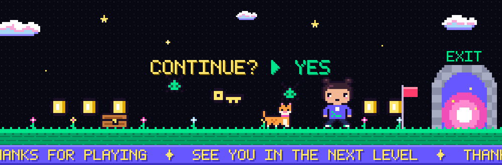

<a href="#about">▲ back to start</a>

